<div align="center">
  

  # Y O R U M I &nbsp; ヨルミ

  **A N I M E &nbsp; · &nbsp; M A N G A &nbsp; · &nbsp; L I G H T &nbsp; N O V E L S**

  *Your all-in-one cross-platform companion for Windows, macOS, Linux, and Android.*

  <br />

  <a href="https://yorumi.vercel.app"></a>
  <a href="https://github.com/davenarchives/Yorumi/releases"></a>
  <a href="https://github.com/davenarchives/Yorumi/releases"></a>
  <a href="https://discord.gg/3xzCQvfanb"></a>

  <br />

  
  
  
  
  
  
</div>

<br />

> [!CAUTION]
> ## ⚠️ Educational Purpose Only — Disclaimer
>
> **Please read carefully before using or contributing:**
>
> 1. **No Content Ownership**: Yorumi does **NOT** host, store, or distribute any copyrighted media files (videos, images, or text). All content is fetched in real time from publicly available third-party sources.
> 2. **Educational Use**: This repository is strictly for **educational and research purposes** demonstrating cross-platform desktop/mobile app architecture, streaming players, and reader interfaces.
> 3. **Legal Liability**: The developers and contributors assume **no liability** for any misuse of this software. Users are solely responsible for complying with local laws and third-party Terms of Service.
> 4. **No Commercial Use**: This project is free, open-source, and not for sale.

<br />

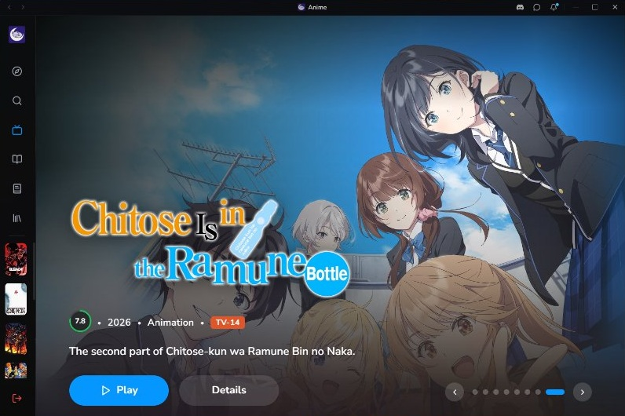

## ✨ Features

- **🎬 HD Anime Streaming**: Watch seasonal simulcasts and classics with HLS playback, sub/dub switching, quality selection, auto-tracking, intro/outro controls, and 2× speed long-press gestures.
- **🔥 Explore Trailer Feed**: TikTok-style vertical anime trailer discovery with personalized recommendations, full-screen tap play/pause, double-tap to like, and long-press for 2× speed.
- **📚 Manga & Manhwa Reader**: Browse trending & Top 100 manga/manhwa with full chapter search, vertical strip or paged reading modes, zoom controls, and fast preloading.
- **📖 Light & Web Novel Reader**: Read Japanese light novels alongside Korean and Chinese web novels with customizable typography, font sizing, spacing, and dark themes.
- **📥 Offline Downloads**: Download anime episodes, manga chapters, and light novel chapters directly to your computer or Android phone to enjoy without Wi-Fi.
- **☁️ Discord Cloud Sync**: Sign in with Discord to sync your continue-watching progress, episode/chapter history, custom library categories, favorites, and watch time seamlessly between PC and Android (powered by Neon Postgres).
- **📊 Personal Library & Stats**: Track your activity heatmap, daily streaks, accurate watch hours, top genres, and custom lists — plus public profiles and Global Chat.
- **💻 True Cross-Platform**:
  - **Desktop**: Native **Tauri v2** app for Windows (`.exe`), macOS (`.dmg`), and Linux (`.AppImage`).
  - **Mobile**: Native **Capacitor** Android app (`.apk`) with immersive landscape playback and native HTTP/download support.
  - **Terminal**: Standalone **[Yorumi CLI](./yorumi-cli)** (`yorumi-cli`) for watching anime directly from your terminal with zero backend setup.

## 📸 Screenshots

### Desktop (Windows / macOS / Linux)
<table>
  <tr>
    <td width="50%">
      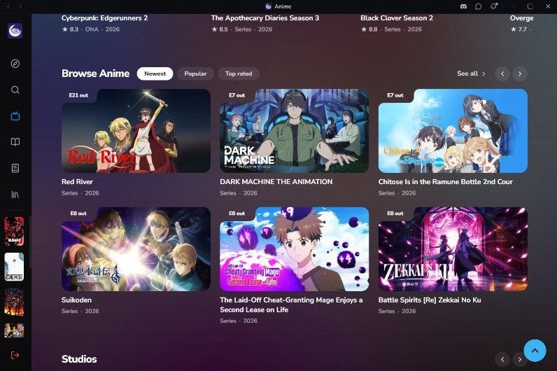
      <p align="center"><b>Browse Anime</b></p>
    </td>
    <td width="50%">
      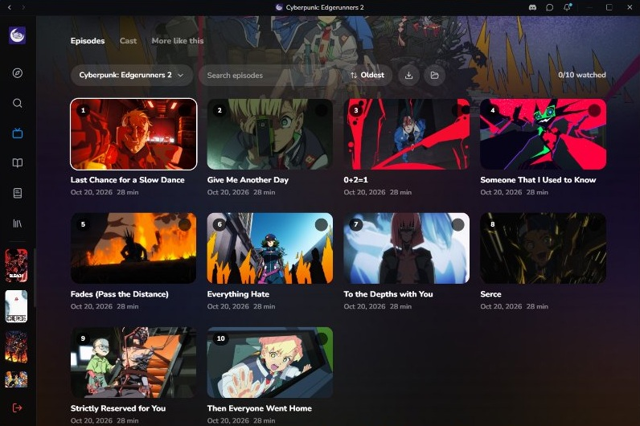
      <p align="center"><b>Episodes & Offline Downloads</b></p>
    </td>
  </tr>
  <tr>
    <td>
      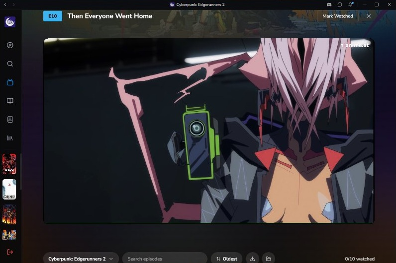
      <p align="center"><b>HD Video Player</b></p>
    </td>
    <td>
      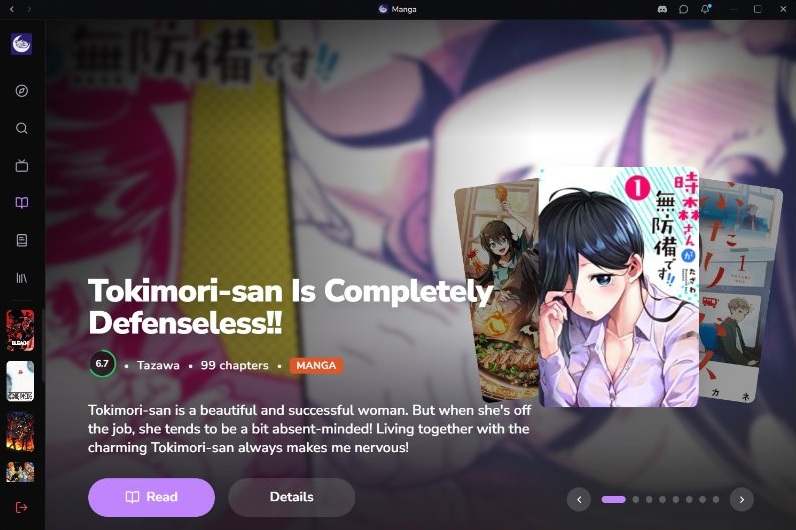
      <p align="center"><b>Manga Discovery</b></p>
    </td>
  </tr>
  <tr>
    <td>
      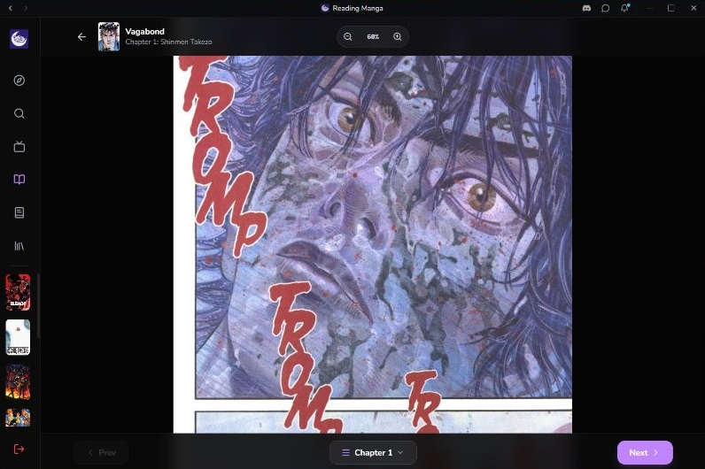
      <p align="center"><b>Manga Reader</b></p>
    </td>
    <td>
      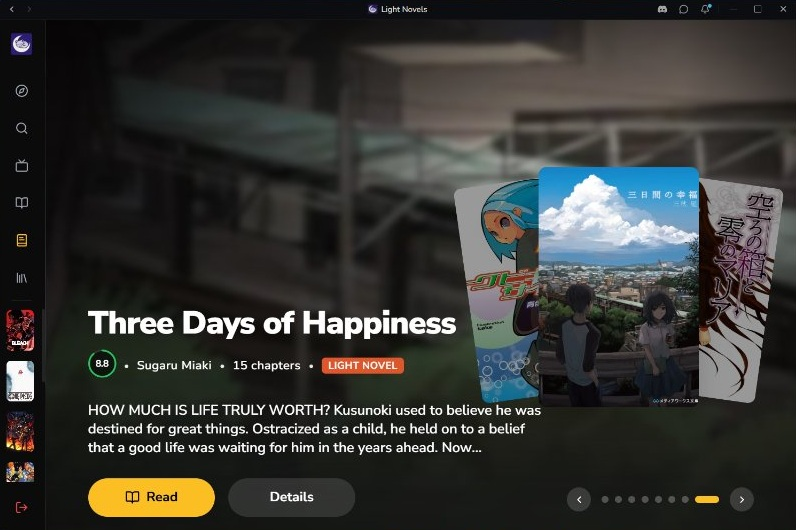
      <p align="center"><b>Light & Web Novels</b></p>
    </td>
  </tr>
  <tr>
    <td>
      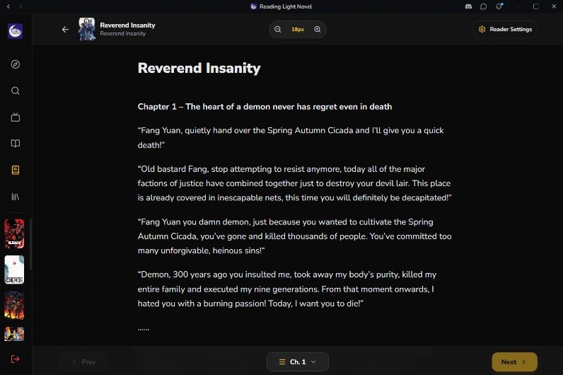
      <p align="center"><b>Light Novel Reader</b></p>
    </td>
    <td>
      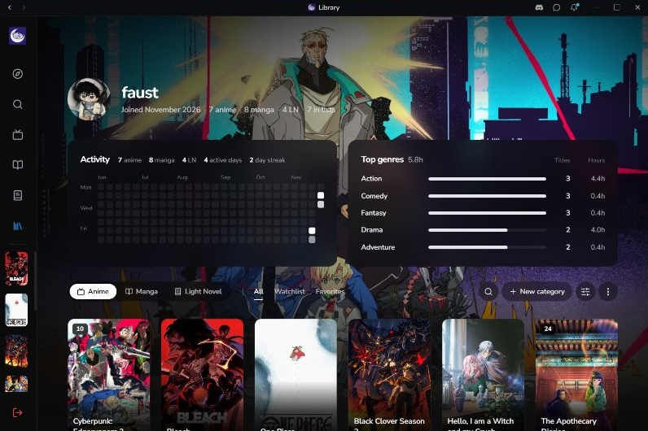
      <p align="center"><b>Library, Activity Heatmap & Watch Stats</b></p>
    </td>
  </tr>
</table>

### Mobile (Android)
<table>
  <tr>
    <td width="25%">
      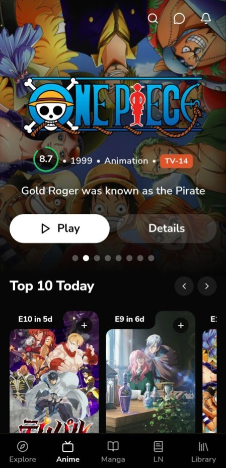
      <p align="center"><b>Anime Home</b></p>
    </td>
    <td width="25%">
      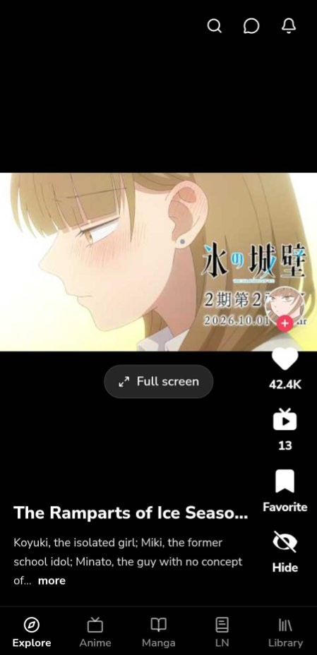
      <p align="center"><b>Explore Feed</b></p>
    </td>
    <td width="25%">
      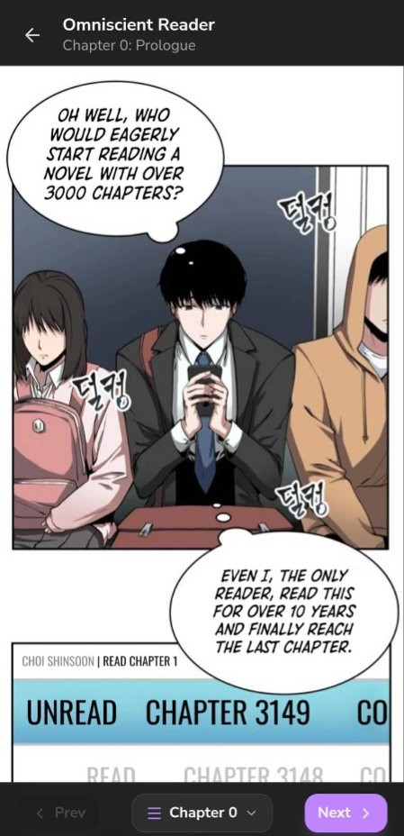
      <p align="center"><b>Manga Reader</b></p>
    </td>
    <td width="25%">
      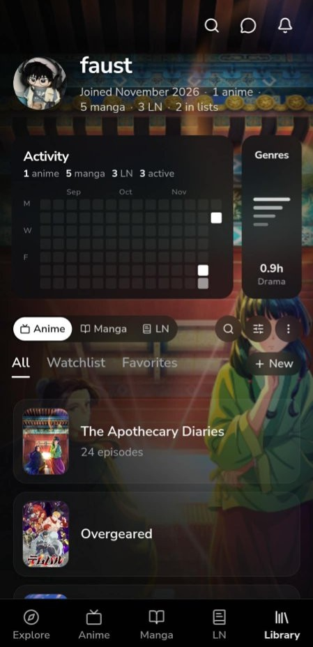
      <p align="center"><b>Library & Stats</b></p>
    </td>
  </tr>
</table>

## 🏗️ Architecture

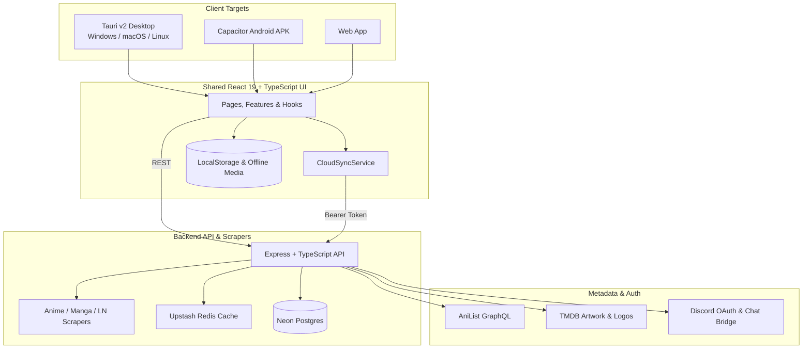

## 🛠️ Tech Stack

- **Frontend**: React 19, TypeScript, Vite (Rolldown), Tailwind CSS, Framer Motion, React Router v7, HLS.js, Embla Carousel, Lucide React
- **Desktop**: Tauri v2 (Rust), native window chrome & Discord Rich Presence
- **Mobile**: Capacitor 8 (Android), native HTTP/proxy bridge, immersive orientation & status/nav bar controls
- **Backend**: Node.js, Express 5, TypeScript, Neon Postgres (`@neondatabase/serverless`), Upstash Redis, Cheerio, Puppeteer Core, Fuzzball
- **Metadata & Media**: AniList GraphQL API, TMDB API (backdrops, episode stills, official logos), Discord OAuth

## 🚀 Getting Started

### Prerequisites
- **Node.js 18+** and **npm**
- **Rust toolchain** (only required for building the Tauri desktop app)
- **Android Studio / JDK 17+** (only required for building the Android APK)

### 1. Clone & Install

```bash
git clone https://github.com/davenarchives/Yorumi.git
cd Yorumi
npm install
npm install --prefix backend
```

### 2. Run Locally

```bash
# Web mode (Backend on :3001 + Vite frontend on :5173)
npm run dev

# Native Desktop app (Tauri v2)
npm run dev:tauri

# Landing Website & Docs
npm install --prefix website
npm run dev --prefix website
```

### 3. Build for Production

```bash
# Bundle backend + build frontend
npm run build

# Build native Desktop installer (.exe / .dmg / .AppImage)
npm run build:tauri

# Build Android APK (Debug / Release)
npm run android:build:debug
npm run android:build:release

# Build Landing Website
npm run build --prefix website
```

### 4. Standalone Terminal CLI (`yorumi-cli`)

Want to watch anime straight from your terminal without running any backend? Check out [yorumi-cli](./yorumi-cli) or the [CLI docs](https://yorumi-cli.vercel.app/docs.html).

## 📁 Project Structure

```text
Yorumi/
├── src/                  # Shared React 19 + TypeScript frontend
│   ├── components/       # Layout, modals, and shared UI
│   ├── features/         # Anime, Manga, LN, Explore, Player, Library
│   ├── hooks/            # State, sync, history, and download hooks
│   ├── pages/            # Route-level views
│   ├── platform/         # Tauri & Capacitor native bridges
│   └── services/         # API clients, cloud sync, TMDB, AniList
├── backend/              # Express API, scrapers, and Neon sync routes
├── src-tauri/            # Tauri v2 desktop wrapper (Rust)
├── android/              # Capacitor Android project
├── website/              # Landing page & documentation site
├── yorumi-cli/           # Standalone anime streaming CLI
└── package.json          # Workspace scripts & dependencies
```

## 🤝 Contributing

Contributions are welcome!

1. Fork the repository
2. Create your feature branch (`git checkout -b feat/amazing-feature`)
3. Commit your changes (`git commit -m "feat: add amazing feature"`)
4. Push to the branch (`git push origin feat/amazing-feature`)
5. Open a Pull Request

## 📄 License

Distributed under the MIT License. See [LICENSE](./LICENSE) for more information.

---

<div align="center">
  Made with ❤️ by <a href="https://github.com/davenarchives"><b>davenarchives</b></a> · <a href="https://ko-fi.com/yorumii">Support on Ko-fi</a>
</div>
