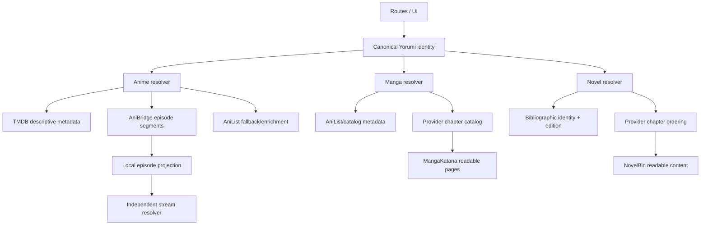

# Yorumi Content Identity and Mapping Audit

Date: 2026-10-12

## Result

Yorumi now has a shared, provider-qualified identity vocabulary and an explicit anime episode-mapping boundary. TMDB remains the primary anime discovery/descriptive source, AniBridge v3 owns anime-to-TMDB episode relationships, and AniList is a fallback/enrichment source. Manga and light-novel records now distinguish metadata identity from reading-provider identity and expose chapter availability instead of treating catalog presence as proof of readability.

This change intentionally does not replace the existing stream, manga-reader, or novel-reader providers. Those providers remain separately addressable because a metadata ID is not a playable/readable ID.

## Repository-grounded flow audit

### Anime

| Journey | Main path | Previous failure | Current ownership |
|---|---|---|---|
| Home/search to details | `animeService` / `searchApi` -> `AnimeContext` -> `AnimeDetailsPage` | A TMDB show record and an AniList season record could overwrite each other; TMDB's 50-episode Shangri-La Frontier season was displayed as one anime season | TMDB discovery/detail identity is retained; `animeMappingService` resolves the TMDB show into AniBridge anime records |
| Details to season/episode | `AnimeDetailsPage` -> `DetailsEpisodeGrid` | Every non-TMDB season chip was treated as AniList; split cours fetched/reused the wrong episode list | `mapping` is a distinct chip source; explicit segments project only owned TMDB metadata onto local episode numbers |
| Episode to player | `DetailsEpisodeGrid` -> `DetailsVideoPlayer` -> stream resolver | Display episode and provider episode could be conflated | Local display number and `playbackEpisodeNumber` remain separate; mapped Season 2 episode 1 can play provider episode 26 |
| Continue watching | storage/watch-key utilities -> details/player | Ambiguous raw numeric IDs could select a different provider record | New identities are provider-qualified; legacy fields remain accepted for existing records |

Root causes were mixed identifier namespaces, implicit season inference, and field-level merging without an authoritative boundary source.

### Manga

The active path is AniList for catalog metadata and MangaKatana for actual chapter lists/pages (`mangaService`, `mangakatana` adapter, `useManga`). Previously `id`, `mal_id`, and `scraper_id` could all contain either a numeric catalog ID or a source slug. A fuzzy title resolution could then make the source slug appear equivalent to the AniList work.

Records now add `yorumiId`, `externalIds`, `mappingStatus`, and `readingProvider` without removing legacy keys. Provider chapters carry provider ID, language, parsed number when present, and availability. MangaKatana listings are `available`; only a successful page fetch promotes a chapter to `readable`; an empty/failed fetch becomes `unavailable`. Volume data is left absent when the provider does not supply it—Yorumi does not invent it.

### Light novels

The active path is AniList/curated data for discovery and NovelBin for chapter listings/content (`lnService`, `novelbin` adapter, LN detail/reader pages). The old title normalizer erased `light novel` and `web novel`, allowing explicitly incompatible editions to compare as the same title.

Edition terms are now preserved, explicit LN/WN conflicts are rejected, and provider records keep an `editionId` plus provider-qualified chapter IDs. A provider listing is `available`; successfully returned non-empty content is `readable`. Unknown-edition candidates can still be resolved for backward compatibility, but remain explicitly `unknown` rather than being relabeled as a light novel.

## External source evaluation

| Source | Decision | Reason |
|---|---|---|
| [AniBridge mappings](https://github.com/anibridge/anibridge-mappings) | Adopted, precedence 1 | Maintained v3 dataset; explicit scoped provider descriptors and episode ranges; aggregates several upstream datasets; MIT license. Release data is cached locally for 24 hours with stale-cache fallback. |
| [Fribb anime-lists](https://github.com/Fribb/anime-lists) | Indirect upstream/fallback reference | Broad cross-database coverage and offsets, but its model is less expressive than AniBridge v3 and AniBridge already consumes Anime-Lists data. No duplicate runtime integration was added. |
| [PlexAniBridge mappings](https://github.com/eliasbenb/PlexAniBridge-Mappings) | Rejected for new reads | Archived 2026-04-05 and explicitly superseded by AniBridge; retained only as historical reference. |
| [anime-metadata-api](https://github.com/historiesofhistory-arch/anime-metadata-api) | Architectural reference only | Demonstrates TMDB metadata slicing from mapping offsets, but uses the older Fribb model and routine live enrichment. Copying it would duplicate Yorumi's metadata and cache layers. |
| [MangaDex API](https://api.mangadex.org/docs/) | Deferred supplemental manga provider | Strong provider-qualified chapters, languages and groups, but adding it requires explicit source selection, rate-limit handling, and a verified AniList/MangaDex mapping. It should not silently replace MangaKatana. |
| [MangaUpdates API](https://api.mangaupdates.com/) | Deferred bibliographic provider | Useful work/release bibliography, not proof of readable pages. Authentication/usage policy and a stable ID crosswalk must be resolved before integration. |
| Existing MangaKatana | Retained as reader provider | Already supplies the actual pages used by Yorumi. Its IDs are now kept in a MangaKatana namespace rather than treated as catalog IDs. |
| Existing NovelBin | Retained as reader provider | Already supplies actual chapter content. Its edition remains independent from the AniList bibliographic entry unless explicitly matched. |

### Anime mapping precedence

1. A valid, closed, one-to-one AniBridge v3 range is `verified` and authoritative.
2. Unsupported open, ratio, non-contiguous target, non-1:1, or multi-show ambiguity is `conflicting`; Yorumi does not guess.
3. If no verified mapping exists, existing TMDB season metadata is shown without claiming anime-specific boundaries.
4. AniList relation hydration is a rare fallback only when the mapping dataset has no result.
5. Stream-provider IDs and numbering are never replaced by TMDB episode IDs.

## Canonical architecture

Shared identity lives in `src/utils/contentIdentity.ts`. Content-specific episode/chapter/edition models remain separate.

## Compatibility and cache behavior

- Existing numeric AniList IDs, `mal_id`, MangaKatana slugs, NovelBin `nb:` IDs, and stored progress records remain readable.
- New records add namespaced identities; no destructive storage migration is required.
- Anime mapping downloads use `YORUMI_ANIME_MAPPING_URL` and `YORUMI_ANIME_MAPPING_CACHE` overrides, a 24-hour refresh, in-flight deduplication, and stale-file fallback.
- The frontend caches positive mappings for 24 hours and misses for five minutes.
- Mapping conflicts are returned as data and never converted into guessed episode metadata.

## Validation coverage

`tests/anime-mapping.test.ts` covers:

- Shangri-La Frontier's two AniList entries mapped to TMDB episodes 1-25 and 26-50.
- Naruto's 220 local episodes spanning four TMDB seasons.
- conflict behavior for non-1:1 ranges.
- projection of TMDB episode metadata back to local numbering.

`tests/content-identity.test.ts` covers provider-qualified identity precedence and LN/WN edition separation.

## Residual limitations

- AniBridge v3 supports open ranges, ratios, and non-contiguous target expressions. Yorumi currently marks those expressions conflicting instead of applying an unsafe partial interpretation. Adding support requires dedicated ordering and playback tests.
- Provider title resolution still exists for manga and novels where no stable crosswalk is available. It is guarded by confirmation and explicit mapping status, but a curated/provider crosswalk is the next durable improvement.
- MangaDex and MangaUpdates were evaluated but not added because doing so without source-selection UX and verified mappings would recreate the same identity bug this work removes.
- Legacy progress remains compatible, but a future opt-in migration can rewrite it to `yorumiId` keys after all library surfaces persist the new field.
